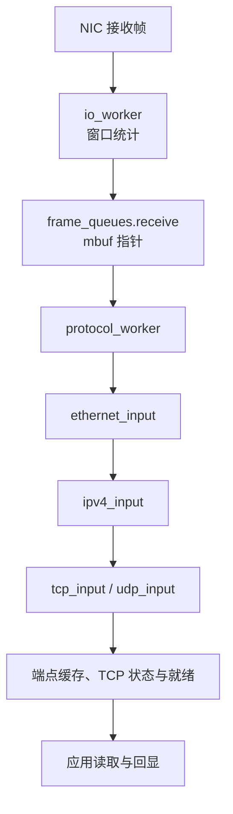
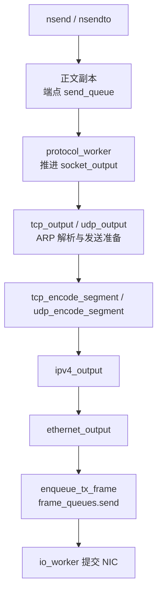

# myProgram：按协议层组织的用户态协议栈

基于 DPDK 的 Linux 用户态 IPv4 协议栈学习项目，提供 UDP/TCP 收发接口、回显应用、多连接可读事件通知，以及通过 KNI 与内核协议栈协作的报文路径。

## 目录与执行角色

| 位置 | 职责 |
| --- | --- |
| main.c | 初始化，启动四个业务执行角色 |
| protocol_worker.c/.h | 协议 lcore 循环、批量输入、KNI 回程、UDP/TCP 输出与定时器推进 |
| network_interface.c/.h | 本地 IP 与 MAC 配置 |
| app/ | UDP 和 TCP 回显应用 |
| socket/ | n* 公开接口和 event_poll 就绪服务 |
| transport/ | TCP/UDP 解析、编码、端点、队列、TCP 状态与生命周期 |
| network/ | IPv4 检查、分派、封装与伪首部校验和，以及自写 ICMP 实现 |
| link/ | Ethernet、ARP、公共帧队列、NIC 帧收发循环 |
| dpdk/ | 网卡初始化与 KNI 适配 |
| monitor/ | ddos 窗口统计及阈值触发处理 |
| third_party/ | 红黑树宏及其许可证 |

主 lcore 在 main 中进入 io_worker；协议 lcore 通过 rte_eal_remote_launch 运行 protocol_worker；两个 pthread 分别运行 UDP、TCP 应用。源文件位置不代表线程归属。

## 数据流

接收路径：



发送路径：



各层输出使用同一份 TX mbuf，逐层封装时不复制正文。ipv4_payload_checksum 提供伪首部校验和；输入保留帧数据起点，通过借用视图访问各层头。

UDP/TCP 由用户态协议栈处理；ARP/ICMP 等报文默认通过 kni_send 交给内核。kni_receive 从内核接收完整帧后，将其送入公共发送队列。自写 ARP/ICMP 应答实现也包含在项目中，默认不与内核同时应答；用户态 ARP 缓存供 UDP/TCP 查询目标 MAC。

## 功能与边界

- UDP 提供数据报收发、接收截断、阻塞等待与关闭处理。
- TCP 提供被动建连、短读、部分发送、发送排队、FIN/EOF、可读通知与对象回收。
- nepoll 提供单实例、TCP 可读事件以及 ADD/MOD/DEL 操作。
- KNI 提供用户态与内核之间的报文分流和回程；NIC 收发与接口控制请求由 I/O 线程处理。
- IPv4 执行项目中的头部、长度及分片拒收检查；未实现 IPv4 首部校验和验证、路由或分片重组。
- ddos 使用 256 包窗口，第 257 包首次评估，阈值为 1200，触发后退出程序。该统计规则可能误报，不能视为已经验证的攻击识别能力。
- TCP 未实现重传、乱序重组、拥塞控制、主动连接或完整主动关闭流程。

## 构建

Makefile 提供 legacy 和 pkg-config 分支。已使用的构建环境为 DPDK 19.08.2 legacy：

```sh
make RTE_SDK=/home/user/code/2.network/2.4/dpdk/dpdk-stable-19.08.2 \
     RTE_TARGET=x86_64-native-linux-gcc
```

其中 RTE_SDK 是当前虚拟机的 DPDK 安装路径，其他环境需按实际位置调整。

## 验证范围

已完成 DPDK 19.08.2 legacy 构建、独立头文件检查、UDP/TCP 及 KNI、窗口统计、多连接就绪通知的进程内检查，并核对输出帧内容。

上述检查不等同于真实网卡端到端验证。真实 NIC 启动、vEth0 配置及外部客户端通信需结合实际环境检查；运行前应核对 PCI、IP 和路由配置。
