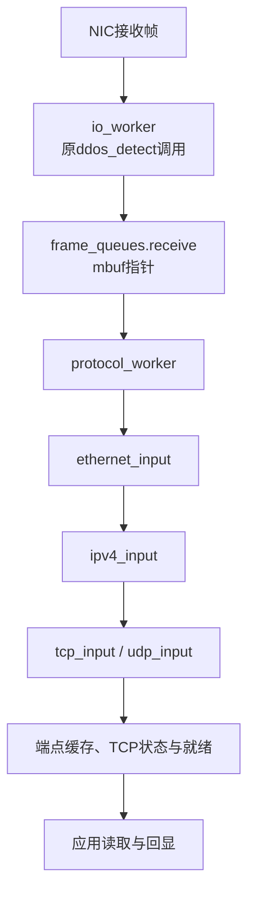
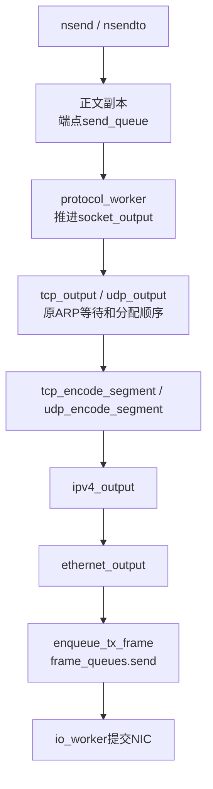

# myProgram：按协议层组织的用户态协议栈

2026-11-03按确认意见书整理目录、命名和封装职责。基线为db6f615（10.30）加本轮开始时的工作树；既有功能和用户未提交逻辑保留。

## 目录与执行角色

| 位置 | 职责 |
| --- | --- |
| main.c | 初始化，启动原有四个业务执行角色 |
| protocol_worker.c/.h | 协议lcore循环、批量输入、KNI回程、UDP/TCP输出与定时器推进 |
| network_interface.c/.h | local_host_ip、local_mac |
| app/ | 原UDP和TCP回显业务 |
| socket/ | n*公开接口和event_poll就绪服务 |
| transport/ | TCP/UDP解析、编码、端点、队列、TCP状态与生命周期 |
| network/ | IPv4检查、分派、封装与伪首部校验和，原自写ICMP |
| link/ | Ethernet、ARP、公共帧队列、NIC帧收发循环 |
| dpdk/ | port_init、KNI适配 |
| monitor/ | 原ddos窗口规则及退出行为 |
| third_party/ | 原红黑树宏和许可证 |

main进入io_worker；rte_eal_remote_launch在协议lcore运行protocol_worker；两个pthread分别运行原UDP、TCP应用。源文件位置不代表线程归属。

## 当前数据流





各层输出使用同一份TX mbuf，不增加逐层正文复制。ipv4_payload_checksum提供伪首部校验和；输入保留原帧数据起点，通过借用视图访问各层头。

默认ARP/ICMP等分支仍交kni_send；kni_receive返回完整帧后直接入公共发送队列。原自写ARP/ICMP实现保留，默认不同时回答。

## 新旧对应

| 旧位置或标识符 | 当前 |
| --- | --- |
| common/packet.c | protocol_worker.c、link/ethernet.c、network/ipv4.c |
| common/net_arch.c | link/frame_queue.c、link/io_worker.c |
| common/app_state.* | network_interface.* |
| protocol/tcp.*、udp.* | transport/对应文件 |
| socket/tcp_socket.*、udp_socket.* | transport/对应文件 |
| protocol/arp.*、icmp.* | link/arp.*、network/icmp.* |
| common/port_init.*、kni.* | dpdk/对应文件 |
| common/ddos.*、nty_tree.h | monitor/ddos.*、third_party/nty_tree.h |
| packet_worker | protocol_worker |
| process_packets | worker逐帧调用ethernet_input |
| net_arch_init、packet_rings_instance | frame_queues_init、frame_queues_instance |
| enqueue_tx_packet | enqueue_tx_frame |
| struct inout_ring、in/out | struct frame_queues、receive/send |
| struct udp_datagram、datagram | struct udp_segment、segment |
| sequence_number、acknowledgement_number | seq_num、ack_num |
| build_arp_packet | build_arp_frame |
| encode_arp_packet、process_arp_packet | arp_encode_frame、arp_input |
| encode_tcp_packet、encode_udp_packet | tcp_encode_segment、udp_encode_segment |
| encode_icmp_packet、process_icmp_packet | icmp_encode、icmp_input |
| build_tcp_packet、build_udp_packet、build_icmp_packet | 原整帧构造职责并入各层输出流程 |

内部segment仍保存正文指针和本地处理信息，收发记录继续共用。公开n*接口、端点缓存、local/remote、source/destination等约定保持。port_init文件名、ddos名称、write_index及第三方API保留。

## 行为边界

- 保留UDP截断、阻塞与关闭；TCP短读、部分发送、发送排队、FIN/EOF、就绪通知与回收。
- 保留KNI分流、回程、控制请求角色，mbuf所有权和公共队列生产/消费角色。
- IPv4仍用原拒收规则，不新增IPv4校验和检查、路由或分片重组。
- ddos保留256包窗口、第257包首次评估、原公式、1200阈值与触发退出。
- 未新增重传、乱序重组、拥塞控制、主动连接或完整主动关闭等功能。
- 原统计触发不代表已验证准确识别攻击；本次重构不增加性能或真实通信结论。

## 构建与验证

Makefile的legacy和pkg-config分支共用新的源码清单。实际构建继续使用DPDK 19.08.2 legacy环境：

```sh
make RTE_SDK=/home/user/code/2.network/2.4/dpdk/dpdk-stable-19.08.2 \
     RTE_TARGET=x86_64-native-linux-gcc
```

本轮备份、差异、检查源码与日志：
/home/user/.codex/code-backups/myProgram-layers-20261103-omdwegz5

编译、进程内检查与输出帧对照的详细结果见本轮验收记录。真实NIC启动、vEth0配置及外部客户端通信未在本轮重测；历史命令执行前应复核PCI、IP和路由。
