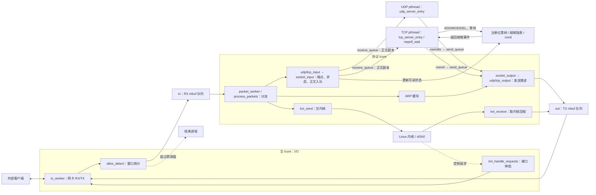

# myProgram：11～13 KNI、窗口检测与 TCP 多连接通知

2026-10-25 在 `dc6e0bb`（10.21）加既有未提交工作树上整合 11～13。
保留 app / socket / protocol / common 分类、已有函数/参数/字段名称，以及用户的 if/else 修改。
没有移动或删除原有源码；本轮不是全项目重命名。原有 UDP socket 文件逐字保持基线内容。

## 本轮相对旧版的变化

| 分类与位置 | 旧行为 → 新行为 | 原因与影响 |
| --- | --- | --- |
| 新增 common/kni.c/.h | 没有内核通道 → 默认创建 vEth0，收发 KNI 报文并服务接口控制请求 | 补齐参考 11 没有实现的内核回程；逐包提交，明确 mbuf 所有权 |
| 新增 common/ddos.c/.h | 没有入口统计 → 网卡 RX 入 in 前统计实际报文的位与窗口指标 | 保留参考的 256 包窗口、公式、1200 阈值和触发退出，修正读取与数值边界 |
| 新增 socket/event_poll.c/.h | 只能等待单个 socket → 红黑树管理注册，就绪链表管理可读对象 | 支持本项目的 nepoll 单实例与多连接读取 |
| 新增 common/nty_tree.h | 无树宏 → 引入参考 13 的红黑树宏 | 原样保留第三方源码及许可证，不要求学习时重写树算法 |
| 修改 main.c | 网卡和 ring 初始化 → 再初始化 KNI，然后启动原有四个执行角色 | 默认需要 rte_kni 模块和 /dev/kni；失败明确退出 |
| 修改 common/net_arch.c | RX 直接入 in → 先检测；I/O 循环同时服务 KNI 控制请求 | NIC 停启与 RX/TX 始终由同一 I/O 角色执行，停用期间不访问 NIC 队列 |
| 修改 common/packet.c/.h | 用户态回答 ARP/ICMP → UDP/TCP 留在用户态，其余报文交 KNI | 交给 KNI 的 mbuf 不再由包循环重复释放；协议循环也处理 KNI 回程 |
| 修改 protocol/arp.c/.h | 仅原有 ARP 输入路径更新表 → 新增 arp_learn，学习有效 ARP/IPv4 来源映射 | 分流后用户态 UDP/TCP 仍有目标 MAC；原 ARP/ICMP 实现保留供对照 |
| 修改 socket/tcp_socket.c/.h | 仅 cond 唤醒 → 同时维护监听/连接的可读状态，关闭时撤销注册 | 注册前已有数据、短读、EOF 和尚有待接受连接均不丢通知 |
| 修改 socket/socket_api.c/.h | 原 n* 接口 → 增加 nepoll_create/ctl/wait，nclose 分派 poll 描述符 | 保留原 socket 接口签名；事件对象和 socket 描述符不冲突 |
| 修改 app/tcp_app.c | 接受一个连接后一直处理它 → 一个事件循环服务多个连接 | 每轮处理就绪连接；保留二进制、短读、部分发送与 EOF 后关闭 |
| 修改 config.h、Makefile | 原构建源列表 → 纳入新模块和数学库 | 两套原构建分支均补充 -lm；ENABLE 定义继续保留，但不用于切换功能 |

上表比较的是本轮开始时的工作树，不将用户原有的 TCP/UDP if/else 改动算作本轮新增。
TCP 文件只清理了基线两处行尾空格，没有撤销其逻辑或重新命名。

## 模块总览与数据交接



跨线程的队列箭头表示生产/消费，不表示生产者直接调用应用函数。
in/out 保存整帧 mbuf 指针；每连接的队列保存独立正文副本；就绪事件只携带注册信息，不携带正文。

| 执行角色 | 创建或安排位置 | 入口与主要工作 |
| --- | --- | --- |
| 主 DPDK lcore | main 直接进入原主循环 | io_worker：KNI 控制请求、网卡 RX、检测、in 入队、out 出队与 TX |
| 协议 DPDK lcore | EAL 已建立 worker，main 用 rte_eal_remote_launch 安排工作 | packet_worker：协议分类、ARP 学习、KNI 发送/回程、UDP/TCP 推进、定时器 |
| UDP 应用 pthread | main 的 pthread_create | run_udp_application → udp_server_entry：原 UDP 回显 |
| TCP 应用 pthread | main 的 pthread_create | run_tcp_application → tcp_server_entry：nepoll_wait 多连接回显 |

仍是四个用户态业务角色，只需两个 DPDK lcore。ARP 定时回调在协议角色运行，不新增业务线程。
KNI 模块有内核侧执行线程，EAL 也可能有辅助线程；四不是实测的进程/系统线程总数。

## KNI 与所有权

- kni_init 在主线程创建单个 vEth0，rte_kni_init 的参数是接口数量 1，不能误传端口编号 0。
- ARP 与 IPv4 来源映射由协议角色学习。UDP/TCP 继续交自写协议栈，其他完整报文交内核。
- kni_send 接管单个 mbuf：KNI 接纳后交由其处理；拒绝或未初始化时释放。不会把同一批报文在循环中重复提交。
- kni_receive 取得内核报文后调用 enqueue_tx_packet；该函数成功入 out、失败释放。out 仍仅由协议角色生产，NIC 仍仅由 I/O 角色操作。
- 内核接口 up/down 的控制回调由 I/O 角色执行；down 后停止 NIC 访问，up 成功后恢复，启动失败保持停止状态。
- 原 process_arp_packet、process_icmp_packet 及其报文构造代码保留，本轮默认分流不再调用它们，不同时产生两份 ARP/ICMP 应答。

## 窗口检测的实际规则

统计 Ethernet 帧实际字节，不读取 buf_len 所代表的未使用缓冲区容量；支持跨 mbuf 段累计。
按字节计数，避免非对齐宽读与尾部越界；不计算 log2(0)，零长度与全零/全一内容均保持有限数值。

保留参考：256 个报文的滚动窗口、原包含长度项的公式、score > 1200 时 rte_exit。
首次评估与参考一致，发生在填满窗口后的下一包，即第 257 包。
没有新增检测关闭选项，也没有将触发动作改成告警后继续。

该公式不是已验证的攻击分类器：256 个 60 字节、相同比例的报文，得分约 2263.257，也会超过阈值。
因此正常流量也可能使程序结束；这证明原规则被触发，不证明发生攻击。重启后窗口重新累计。

## nepoll 接口、语义与生命周期

公开入口统一位于 socket/socket_api.c：

```c
int nepoll_create(int size);
int nepoll_ctl(int epoll_fd, int operation, int socket_fd, struct epoll_event *event);
int nepoll_wait(int epoll_fd, struct epoll_event *events, int max_events, int timeout_ms);
int nclose(int socket_fd);
```

复用系统头文件定义的 struct epoll_event 和 EPOLL_CTL_* 常量，但函数实际操作本项目对象，不调用 Linux epoll。
size 为正的兼容提示；本轮只允许一个实例。UDP fd 为 3～66，TCP 对象为 67～130，poll fd 为 131。
TCP 总对象上限仍为 64，包括监听对象、半连接与尚未回收对象，不等于 64 个应用连接。

仅支持 TCP 的 EPOLLIN 与 ADD/MOD/DEL；其他事件模式返回 EOPNOTSUPP，不声称支持 EPOLLET、EPOLLOUT、嵌套实例或 UDP 事件。
监听存在待接受连接时可读；连接存在未读正文或可返回 EOF 时可读。短读后仍保留通知，EOF 直到关闭前仍可读。
同一 fd 不重复进入就绪链表，每次 wait 中至多返回一次；轮转就绪项，避免小 max_events 长期饿死其他连接。
ADD/MOD 在 TCP 锁内取得当前可读状态，覆盖数据或握手先于注册发生的情况。

锁顺序固定为 TCP 注册表锁 → poll 锁。wait 仅持 poll 锁，不反向访问 TCP。
同一把 poll 锁保护注册树、就绪谓词、链表及 cond 等待，避免分裂谓词/通知导致丢唤醒。
timeout_ms 为 0 时立即返回、负数时等待、正数时使用固定单调时钟截止时间；空就绪超时返回 0。
关闭 socket 自动移除注册；关闭 poll 唤醒等待者并返回 EBADF，最后一个等待调用退出后才释放实例。
应用保持单个事件消费者，并独占其监听/连接读取；现有阻塞接口未扩展为完整 POSIX 非阻塞接口。

## 命名与兼容范围

既有函数、参数、字段名称保持不变。新增代码延续层次明确、同类对偶、snake_case、四空格和 if/else。
receive/send 表示应用读写，input/output 表示各层推进；source/destination 描述报文方向，local/remote 描述连接身份。
新增代码的长度/数量分别采用 length/count；保留 fd/ip/mac 等通用缩写。没有为形式对称新增无用途包装。

原有 UDP 数据报边界、TCP 短读、发送排队、ARP 等待、被动 FIN/EOF 与 LAST_ACK 回收沿用。
仍未加入重传、乱序重组、拥塞控制、主动连接、完整主动关闭、RST 恢复、IPv4 分片重组或后台超时回收。
原 nlisten backlog 参数仍不执行队列容量限制。继承的简化 ICMP 代码没有扩大修复范围。

## 已完成的验证（2026-10-25）

- DPDK 19.08.2 legacy 编译和链接无警告；18 个头文件独立编译通过。
- 原 UDP 检查 11,542 项通过；原 TCP 检查 3,308 项通过，唯一验证流程调整是显式关闭新 poll 实例，结束事件循环。
- 新增 3,114 项定向检查通过：KNI 混合分流与拒收释放、回程队列满、接口停启失败；检测实际长度、保护页边界、分段报文、零值、窗口与阈值；注册前就绪、短读、EOF、重复通知、MOD/DEL、满容量注册、公平轮转、多等待者关闭与描述符复用。
- 运行真实 TCP 应用循环的进程内检查：第一个客户端保持空闲时第二个客户端仍能回显；1400 字节跨应用短读完整回显，两连接均完成 FIN/ACK 回收。
- 独立进程实测原阈值退出：第 257 个 60 字节样本使 score=2263.257，退出码 1。
- 上述网络检查使用无 PCI 探测的进程内报文与模拟 KNI/网卡调用；没有运行真实数据 NIC，也没有配置 vEth0 或发外部报文。

基线、测试辅助源码、运行日志及本轮差异保存在：
`/home/user/.codex/code-backups/myProgram-11-13-20261025-q40yzfql`。
测试文件不进入学习项目，也没有提交或推送。

## 由用户执行的真实通信验收

已只读核实：数据 NIC 0000:0b:00.0 绑定 igb_uio；管理 NIC ens160 使用 192.168.27.128/24；模块 rte_kni 已加载。
执行前仍核对设备归属，不改管理网卡。以下配置命令尚未执行。

```sh
cd /home/user/code/program/tcp-stack/myProgram
make RTE_SDK=/home/user/code/2.network/2.4/dpdk/dpdk-stable-19.08.2 \
     RTE_TARGET=x86_64-native-linux-gcc
sudo ./build/myProgram -l 0-1 -n 4 -w 0000:0b:00.0
```

保持程序运行，在另一个终端配置本次创建的接口：

```sh
sudo ip addr add 192.168.27.8/24 dev vEth0
sudo ip link set vEth0 up
ip -brief address show vEth0
ip route get 192.168.27.1 from 192.168.27.8
```

最后一条检查内核到客户端的回程是否使用 vEth0。192.168.27.1 是此前 Windows 客户端地址，按实际客户端替换。
管理网卡也在同一子网，若查询显示走 ens160，可由用户仅为客户端增加临时主机路由后复查：

```sh
sudo ip route add 192.168.27.1/32 dev vEth0 src 192.168.27.8
# 撤销刚添加的路由：
# sudo ip route del 192.168.27.1/32 dev vEth0
```

如果该 /32 路由已经存在，先检查其用途，不覆盖现有路由。

验收顺序与观察点：

1. 客户端 ping 192.168.27.8：确认 KNI/内核的 ARP 与 ICMP 双向路径；只创建了接口不算通过。
2. UDP 8889 发送 nihao 及含 00 的二进制，确认回复字节完全相同。
3. 两个 TCP 客户端同时连接 9999，先保持 A 空闲，让 B 发送并收到回显，再让 A 发送；两者应独立回显。
4. 发送大于 1024 字节的数据验证应用短读后的后续通知；客户端必须累计读取 TCP 字节流，不能把一次 recv 当成完整消息。
5. 客户端关闭发送方向并继续读取至 EOF，再重新连接，观察资源是否复用。
6. 若程序出现 Reference DDoS threshold exceeded，则按上述原规则核对，不将其误记为 TCP 或 KNI 崩溃，也不据此认定攻击。

实际网络可能在窗口触发后中断，长时间、多次发包验收会受到原规则影响；不将进程内验证写成真实通信已成功。
